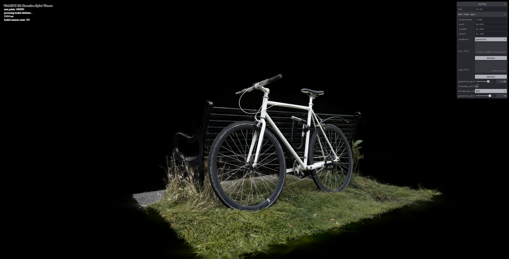
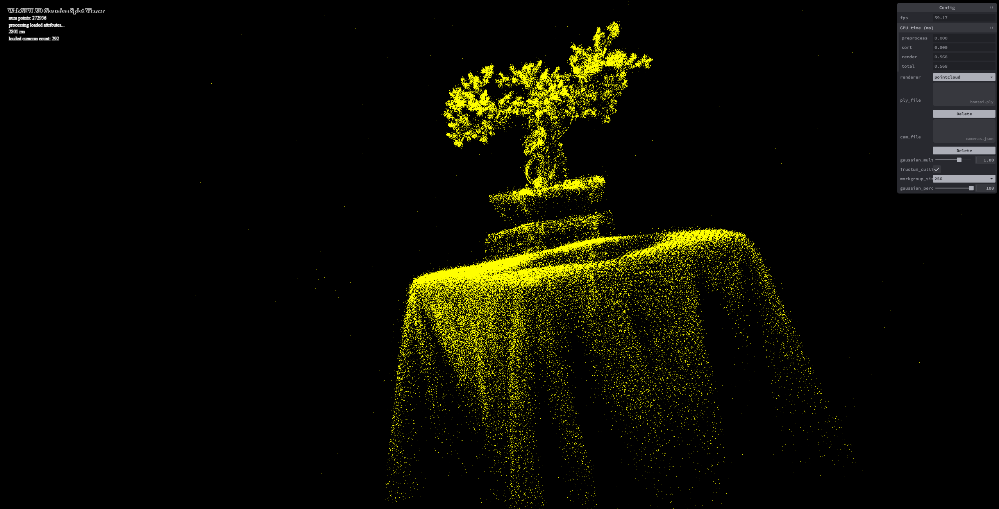
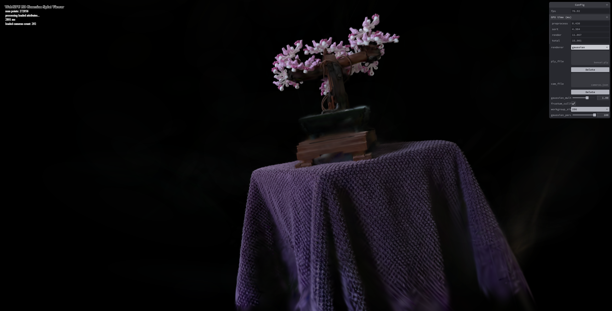
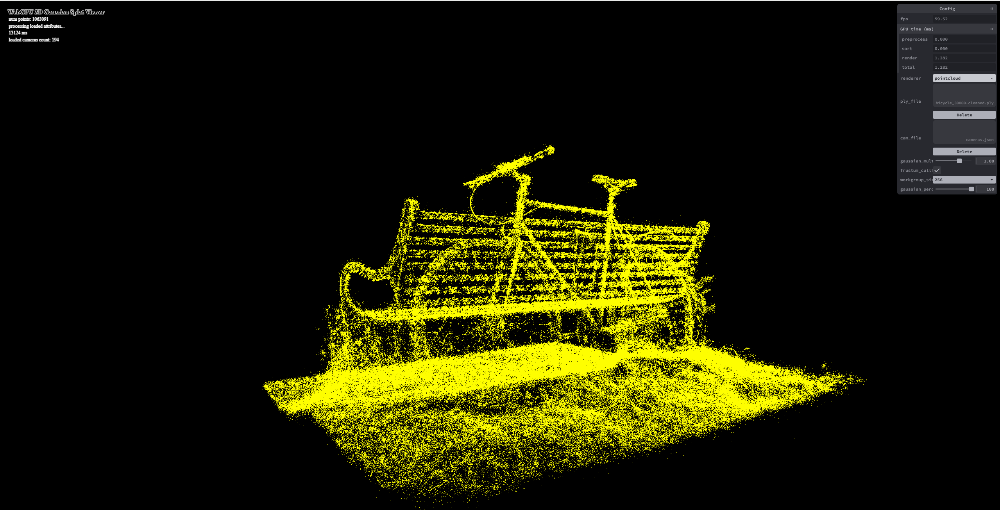
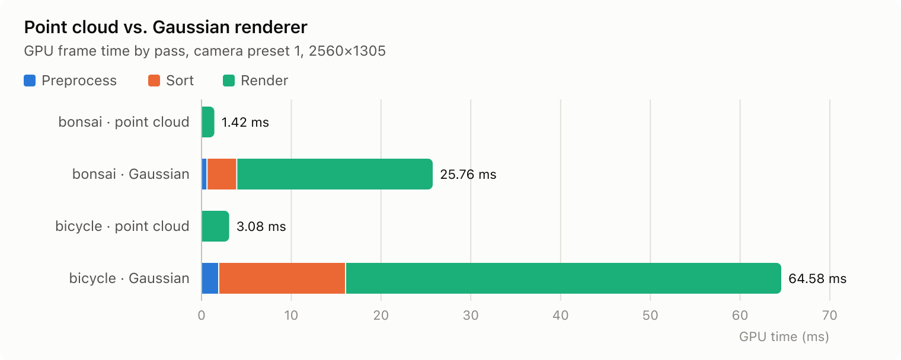
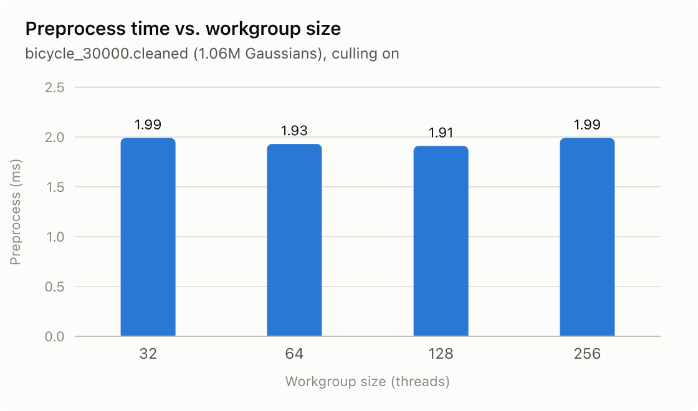
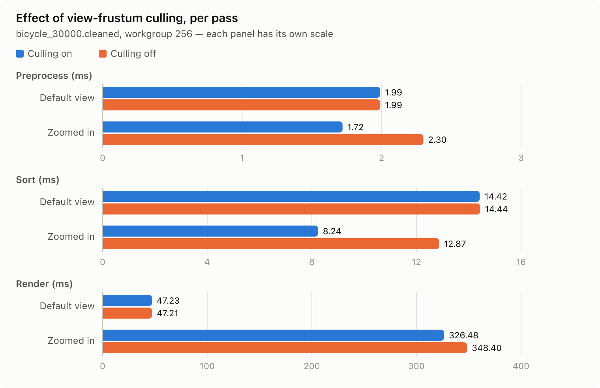
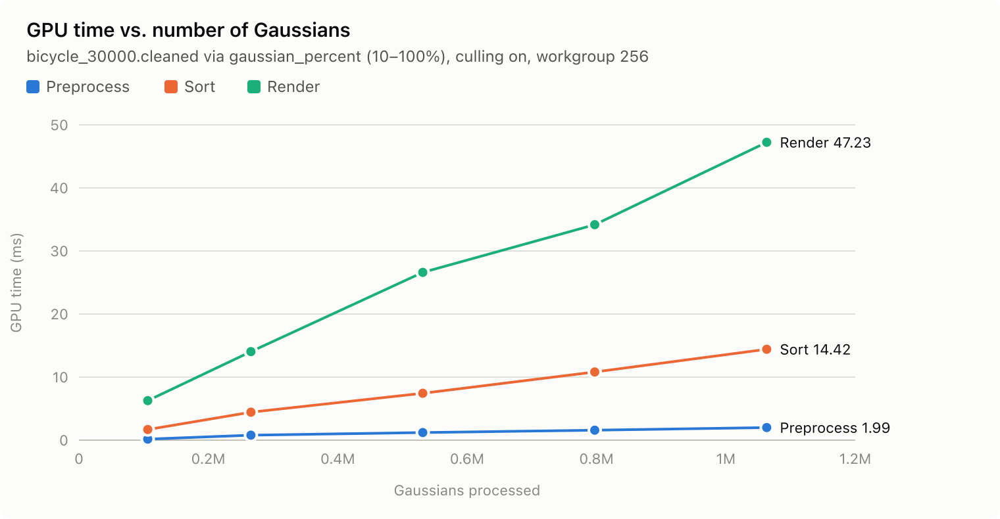

# Project5-WebGPU-Gaussian-Splat-Viewer

**University of Pennsylvania, CIS 565: GPU Programming and Architecture, Project 5**

* Gordon Kim
* Tested on: **Google Chrome 156.9.8078.48** on
  Windows 11 Education, Intel Core i7-14700 @ 2.10GHz 32GB, NVIDIA T1000 (TODO: 4/8)GB, driver 32.0.15.9686 (Moore lab)

### [Live Demo](https://rlarkdfus.github.io/Project5-WebGPU-Gaussian-Splat-Viewer)

> [!WARNING]
> **Does not run on macOS.** In my testing, opening the viewer on a Mac crashed the entire computer.
> Use Windows with Google Chrome instead.

### Demo Video/GIF

https://github.com/user-attachments/assets/7ab9d79b-e0e9-40c8-8fa0-cce7574b8c2c

## Overview

A real-time viewer for pretrained [3D Gaussian Splatting](https://repo-sam.inria.fr/fungraph/3d-gaussian-splatting/)
scenes, written in TypeScript + WGSL on WebGPU. A `.ply` scene is uploaded to the GPU, and each frame runs
a compute preprocess pass, a GPU radix sort by depth, and an indirect instanced draw of one screen-space quad
per visible Gaussian, alpha-blended back to front.

| Scene | Point Cloud | Gaussian Splats |
| --- | --- | --- |
| bonsai |  |  |
| bicycle |  |  |

## Features

### Part 1: Point Cloud Renderer
- Added MVP transform to the point cloud vertex shader (`src/shaders/point_cloud.wgsl`), rendering each
  Gaussian center as a yellow point.

### Part 2: Gaussian Renderer
Each frame, a compute pass culls off-screen Gaussians and projects the rest into 2D screen-space splats with
view-dependent color, a GPU radix sort orders them back to front, and each splat is drawn as an alpha-blended quad.

### Performance toggles (GUI)
Added to make the performance analysis below reproducible from the browser:
- `frustum_culling` — turns the NDC culling test on/off.
- `workgroup_size` — switches the preprocess compute pipeline between 16 … 1024 threads per workgroup
  (one pipeline is precompiled per size, filtered by the device's limits).
- `gaussian_percent` — processes only the first N% of the Gaussians in the file, to measure scaling with
  Gaussian count.

### GPU pass timing
- Uses the WebGPU `timestamp-query` feature (requested only if the adapter supports it) to record GPU
  timestamps at the start and end of the preprocess, sort, and render passes
  (`src/utils/gpu-timer.ts`).
- Timestamps are resolved and read back asynchronously so timing never stalls the frame, then averaged over
  30 frames and shown in the GUI under GPU time (ms), along with total (start of the first pass to
  the end of the last).

## Performance Analysis

### Methodology

All numbers are GPU time in milliseconds from the GUI's GPU time (ms) panel, averaged over 30 frames
with the camera held still. Chrome was launched with `--enable-webgpu-developer-features` for full-precision
timestamps, and every comparison uses the same scene, camera preset, and window size.

**Test setup:** canvas 2560×1305 (maximized window); scene and camera are listed above each table.

### Point Cloud vs. Gaussian Renderer

| Scene | # Gaussians | Point Cloud total (ms) | Gaussian preprocess (ms) | Gaussian sort (ms) | Gaussian render (ms) | Gaussian total (ms) |
| --- | --- | --- | --- | --- | --- | --- |
| bonsai_30000 | 272,956 | 1.42 | 0.68 | 3.31 | 21.77 | ~25.76 |
| bicycle_30000.cleaned | 1,063,091 | 3.08 | 1.98 | 14.13 | 48.47 | ~64.58 |

The point cloud renderer is about 20× faster (1.42 vs. 25.76 ms on bonsai, 3.08 vs. 64.58 ms on bicycle).
It draws one pixel per Gaussian, while the Gaussian renderer also sorts every Gaussian and alpha-blends a large
quad for each one. Blending the overlapping quads is the main cost (75–85% of the frame).

### Preprocess Workgroup Size

Scene `bicycle_30000.cleaned` (1,063,091 Gaussians), Gaussian renderer, culling on, camera preset 1.

| Workgroup size | Preprocess (ms) | Sort (ms) | Render (ms) | Total (ms) |
| --- | --- | --- | --- | --- |
| 32 | 1.99 | 14.35 | 46.84 | ~63.18 |
| 64 | 1.93 | 14.39 | 47.20 | ~63.51 |
| 128 | 1.91 | 14.42 | 47.23 | ~63.56 |
| 256 | 1.99 | 14.42 | 47.23 | ~63.65 |

16 exceeds the dispatch limit for this scene, and 512/1024 exceed the T1000's workgroup limit.

Workgroup size made no real difference (1.91–1.99 ms, within noise). Every size is a multiple of the 32-thread
warp and the threads don't share data, so the GPU stays equally busy either way. Preprocess is also only about
3% of the frame.

### View-Frustum Culling

Scene `bicycle_30000.cleaned` (1,063,091 Gaussians), Gaussian renderer, workgroup size 256.

| View | Culling | Preprocess (ms) | Sort (ms) | Render (ms) | Total (ms) |
| --- | --- | --- | --- | --- | --- |
| Default camera (preset 1) | On | 1.99 | 14.42 | 47.23 | ~63.65 |
| Default camera (preset 1) | Off | 1.99 | 14.44 | 47.21 | ~63.64 |
| Zoomed in (most Gaussians off-screen) | On | 1.72 | 8.24 | 326.48 | ~336.44 |
| Zoomed in (most Gaussians off-screen) | Off | 2.30 | 12.87 | 348.40 | ~363.57 |

Culling made no difference at the default camera because almost the whole scene is on screen. Zoomed in, it
was 7.5% faster (336 vs. 364 ms), mostly from sorting fewer Gaussians (sort −36%). Render barely improved
(−6%) because the GPU already skips off-screen quads; the zoomed-in cost comes from large on-screen splats.

### Number of Gaussians

Scene `bicycle_30000.cleaned`, Gaussian renderer, culling on, workgroup size 256, camera preset 1.

| `gaussian_percent` | # Gaussians processed | Preprocess (ms) | Sort (ms) | Render (ms) | Total (ms) |
| --- | --- | --- | --- | --- | --- |
| 10% | 106,309 | 0.17 | 1.68 | 6.27 | ~8.12 |
| 25% | 265,772 | 0.79 | 4.44 | 14.04 | ~19.27 |
| 50% | 531,545 | 1.20 | 7.43 | 26.60 | ~35.23 |
| 75% | 797,318 | 1.59 | 10.82 | 34.17 | ~46.58 |
| 100% | 1,063,091 | 1.99 | 14.42 | 47.23 | ~63.65 |

Frame time grows roughly linearly with the number of Gaussians because every pass does work per Gaussian.

## Credits

- [Vite](https://vitejs.dev/)
- [tweakpane](https://tweakpane.github.io/docs//v3/monitor-bindings/)
- [stats.js](https://github.com/mrdoob/stats.js)
- [wgpu-matrix](https://github.com/greggman/wgpu-matrix)
- Special Thanks to: Shrek Shao (Google WebGPU team) & [Differential Guassian Renderer](https://github.com/graphdeco-inria/diff-gaussian-rasterization)
